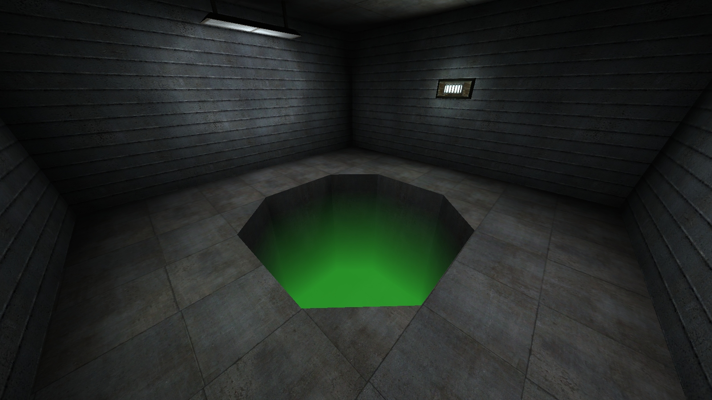
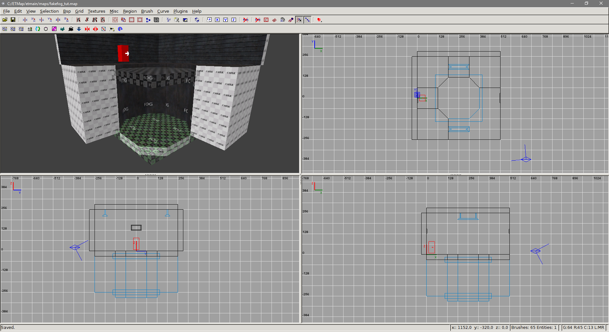
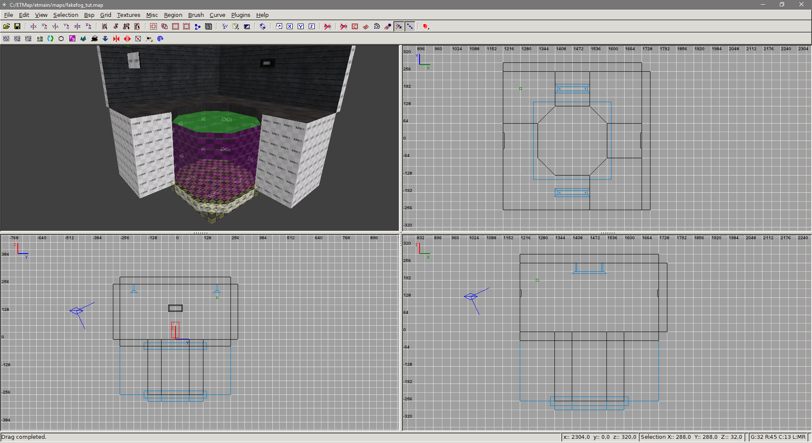
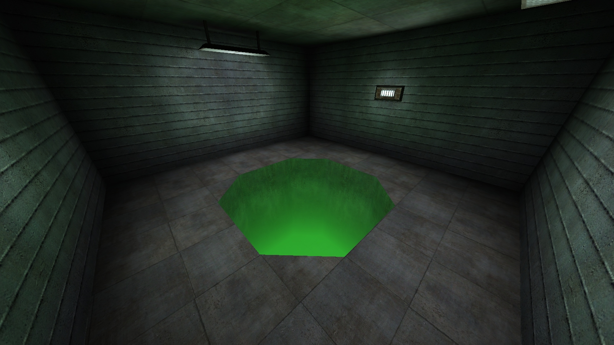
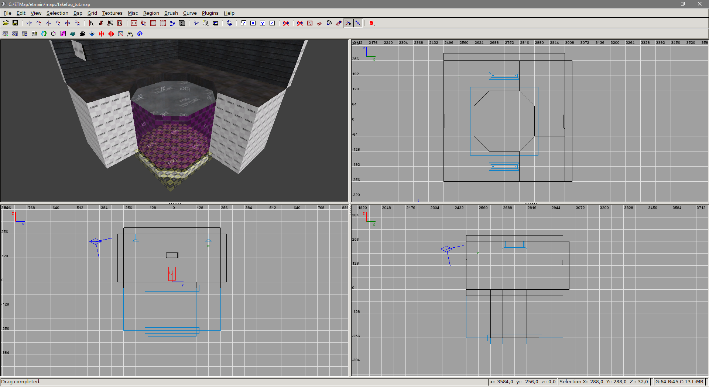
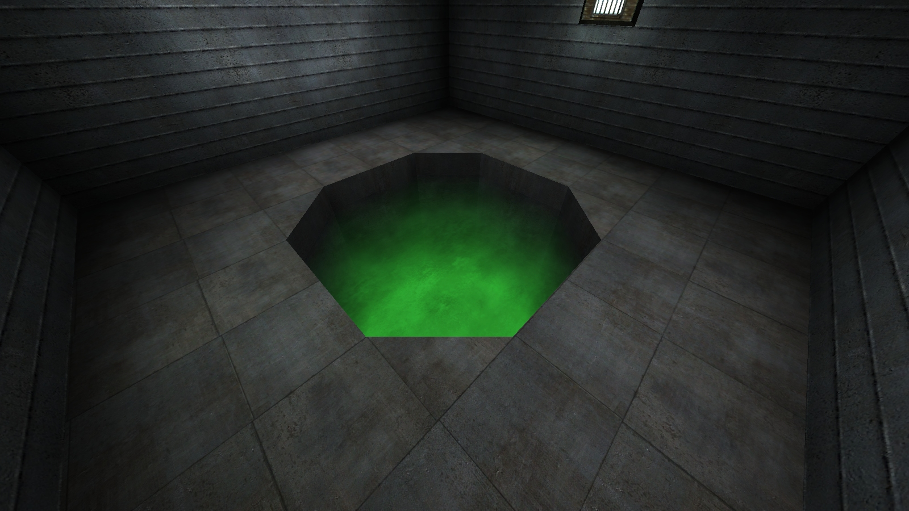
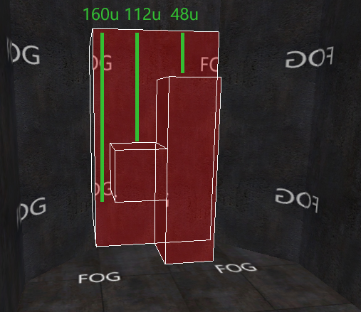
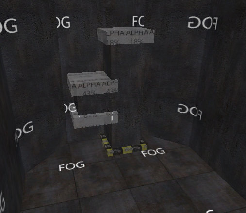
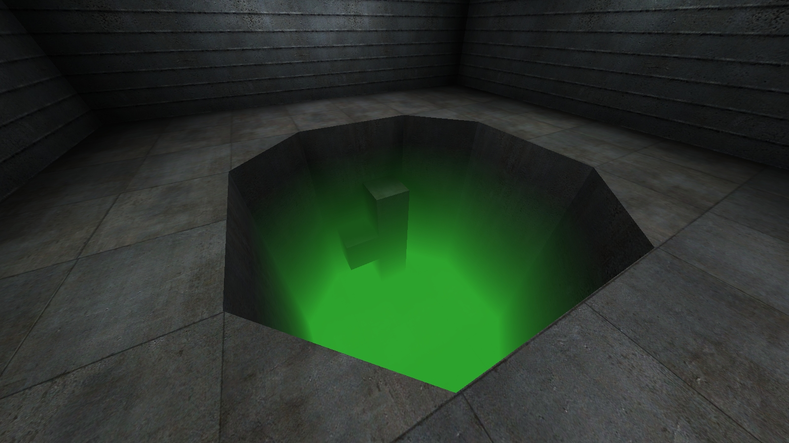

This tutorial teaches how to create fake, static directional fog by using `whiteimage` and alpha blending. The advantage
with this is that the fog always looks the same, regardless of players position of viewangles; standard fog in ET is
distance based with linear fade. Because of this, it's basically unusable for creating fogpits and such, because the
player can often be far enough away from the fog that it turns fully opaque without any fading. To fix this, the fog
shaders distance to opaque parameter would need to be increased, which leads it to look bad when viewed close up.

This tutorial assumes you have basic knowledge on shaders: what they are and how to create them. It's recommended to
check [shader manual](https://garux.github.io/shaderManual/contents.html) for shader directives used here if you are
unfamiliar with them.

If you aren't familiar with the concept of alpha blending, check out Sock's tutorial
[here](http://www.simonoc.com/pages/articles/terrain2_1.html).

If you don't have alphamod shaders, you can grab them at the
[ETJump mapping repository](https://github.com/etjump/mapping).

You can grab the source files used in this tutorial [here](/tutorials/sourcefiles/fakefog_tut.zip).

## Standard fading fog

By using `whiteimage`, a solid white texture can be applied on top of a surface. With `rgbGen` and alphamod brushes, it
can be recolored and used to create fading effect on surfaces which are touching the fog.



In the picture above, the walls and floor of the pit are fogged using `whiteimage` and alpha blending. The shaders look
like this:

```text
// Standard fogged surfaces

textures/fakefog_tut/concrete_m05c_fog
{
    qer_editorImage textures/fakefog_tut/ei/concrete_m05c_fog.jpg
    surfaceparm nomarks
    {
        map $lightmap
        rgbGen identity
    }
    {
        map textures/miltary_wall/concrete_m05c.jpg
        blendFunc GL_DST_COLOR GL_ZERO
        rgbGen identity
    }
    {
        map $whiteimage
        blendFunc GL_SRC_ALPHA GL_ONE_MINUS_SRC_ALPHA
        alphaGen vertex
        rgbGen const ( 0.2 0.75 0.2 )
    }
}

textures/fakefog_tut/concrete_c07bcmp_fog
{
    qer_editorImage textures/fakefog_tut/ei/concrete_c07bcmp_fog.jpg
    surfaceparm nomarks
    {
        map $lightmap
        rgbGen identity
    }
    {
        map textures/miltary_wall/concrete_c07bcmp.jpg
        blendFunc GL_DST_COLOR GL_ZERO
        rgbGen identity
    }
    {
        map $whiteimage
        blendFunc GL_SRC_ALPHA GL_ONE_MINUS_SRC_ALPHA
        alphaGen vertex
        rgbGen const ( 0.2 0.75 0.2 )
    }
}
```

`whiteimage` creates a solid white image on top of the surface. It is then faded using alphamod brushes and `blendFunc`
and `alphaGen` shader directives. Lastly, the color is changed using `rgbGen`. `surfaceparm nomarks` is used to prevent
bullet holes in the fog, as it would look silly.

It's important to note that the `whiteimage` is the last stage of the shader. This is because alphamod brushes modify
the vertex alpha of the last texture map stage. In Radiant, the surfaces affected by the fog and alphamod brushes are
grouped into `func_group`. This is to prevent the alphamod brushes affecting any other surfaces than the group they
belong to. Note that if you want the fog to turn fully opaque at the bottom, it's not necessary to cover the bottom
vertices with an alphamod brush, since the `whiteimage` doesn't have alpha channel.



## Fog with surfacelight

If you want the fog to emit light, first create the fogged area with the standard fog surface shaders as shown above.
Then, create a new shader that's used to emit light.

```text
// Surfacelight "fill" shader

textures/fakefog_tut/fog_surfacelight
{
    qer_editorImage textures/fakefog_tut/ei/fog_surfacelight.jpg
    qer_trans 0.5
    q3map_lightImage textures/fakefog_tut/li/li_fog.jpg
    q3map_surfaceLight 200
    surfaceparm trans
    surfaceparm nonsolid
    surfaceparm nolightmap
    cull none
    {
        map $whiteimage
        blendFunc GL_SRC_ALPHA GL_ONE_MINUS_SRC_ALPHA
        alphaGen const 0.0
    }
}
```

In this shader, `whiteimage` is set to fully transparent with `alphaGen const 0.0`. Light is produced with
`q3map_surfaceLight` and the color is set using `q3map_lightImage`. Color can also be set with `q3map_lightRGB`, however
it doesn't affect radiosity light, while lightimage does. The lightimage is just a small texture, colored to match the
color of the fog. It's not necessary to explicitly set `q3map_lightImage` or `q3map_lightRGB`; if neither are present,
light color is sampled from editor image, which can be made to match the color of the fog. It's also recommended to set
`cull none` to create more uniform lighting.

The reason for using whiteimage here at all is to prevent the surface showing as missing texture in game.
`surfaceparm nodraw` cannot be used either, since `q3map_surfaceLight` doesn't work then.

Create a brush that fills the entire fogged area. Texture the top of this brush with the surfacelight shader, and rest
with `nodraw`.





## Fog with texture

Creating fog with textured top follows the same principle as fog with surfacelight. Create the fogged area normally,
then create a brush that fills the fogged area. Create a shader that has the texture you want to show.

```text
// Textured fog

textures/fakefog_tut/fog_texture
{
    qer_editorImage textures/fakefog_tut/ei/fog_texture.jpg
    qer_trans 0.5
    surfaceparm trans
    surfaceparm nonsolid
    surfaceparm nolightmap
    cull none
    {
        map textures/skies_sd/battery_clouds.tga
        blendFunc GL_DST_COLOR GL_ONE
        tcMod scroll 0.01 -0.01
        rgbGen identity
    }
    {
        map textures/skies_sd/battery_clouds.tga
        blendFunc GL_DST_COLOR GL_ZERO
        tcMod scroll 0.01 -0.01
        rgbGen identity
    }
}
```

This shader doesn't really have anything special. If you want it to emit light, just add `q3map_surfaceLight` and
optionally set the color using any of the methods described earlier.





## Objects inside fog

This is where things get a bit tricky. If you have brushes that are fully inside the fogged area, they have to be faded
seperately from the main area. Because the top/bottom vertices aren't necessarily on the same level as the main fogged
area, some math is required to get the correct alpha values. The formula for calculating this is following:

`alpha = (distanceFromTop / fogHeight) * bottomAlphaMod`

A very simple way to get the correct alpha value is to use
[aspect ratio calculator](https://andrew.hedges.name/experiments/aspect_ratio/). Using this tool, set `fogHeight` as
`W1`, `distanceFromTop` as `H1` and `bottomAlphaMod` as `W2`. `H2` will be your correct alpha value.



In the example map, `bottomAlphaMod` is set to 85%. Fogged area is **224 units** high, and the relevant
`distanceFromTop` values are pictured above. When inserted into the formula, it gives the following alpha values:

```
(48 / 224) * 85 = 18
(112 / 224) * 85 = 43
(160 / 224) * 85 = 61
```

Once the correct alpha values are calculated, create alphamod shaders with the corresponding values.

```text
// Custom alphamod shaders

textures/fakefog_tut/alpha_018
{
    qer_editorImage textures/fakefog_tut/ei/alpha_018.jpg
    q3map_alphaMod volume
    q3map_alphaMod set 0.18
    surfaceparm nodraw
    surfaceparm nonsolid
    surfaceparm trans
    qer_trans 0.3
    qer_noCarve
}

textures/fakefog_tut/alpha_043
{
    qer_editorImage textures/fakefog_tut/ei/alpha_043.jpg
    q3map_alphaMod volume
    q3map_alphaMod set 0.43
    surfaceparm nodraw
    surfaceparm nonsolid
    surfaceparm trans
    qer_trans 0.3
    qer_noCarve
}

textures/fakefog_tut/alpha_061
{
    qer_editorImage textures/fakefog_tut/ei/alpha_061.jpg
    q3map_alphaMod volume
    q3map_alphaMod set 0.61
    surfaceparm nodraw
    surfaceparm nonsolid
    surfaceparm trans
    qer_trans 0.3
    qer_noCarve
}
```

Place the brushes inside the fog into a seperate `func_group` together with the alphamod brushes.





_Tutorial by {frontmatter.author}_
