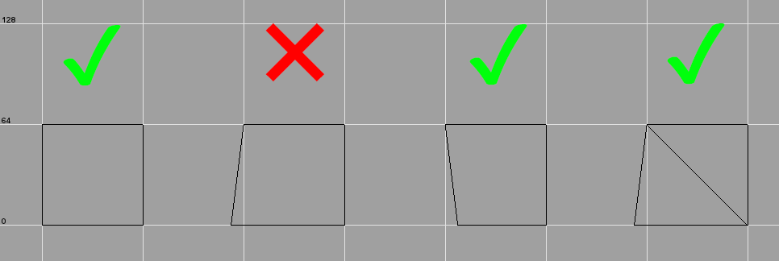

import ShaderRow from '../../components/ShaderRow.astro';

This page contains general information, limits and sizes that are useful to know when mapping for ETJump. All
measurements assume `pmove_fixed 1` and `com_maxfps 125` unless stated otherwise.

## Player sizes

Values are rounded to integers to match grid in Radiant. Actual values for clearances can be lower, as long as they are
still bigger than the bbox.

- Player model size (bbox) - **36x36x72** (XYZ)
  - This is the size of `info_player_deathmatch` entity.
- Minimum horizontal clearance - **37 units**
- Minimum vertical clearance
  - Standing - **73 units**
  - Crouching - **49 units**
  - Proning - **41 units**
  - Jumping - **121 units**

## Movement

### Speed

#### Ground

| Style         | Max speed (units/s) |
| ------------- | ------------------- |
| Sprint        | 352                 |
| Run           | 256                 |
| Walk          | 129                 |
| Walk + sprint | 177                 |
| Crouch        | 80                  |
| Prone         | 67                  |
| Groundstrafe  | 452                 |
| Wallstrafe    | 442                 |

#### Water

If water level is < half of your height (stance dependant), you are still walking normally but your speed is clamped to
**267 units/s**.

_Following values assume axial yaw. Non-axial yaw can provide higher speeds._

- Swimming in water - **160 units/s**
  - With **35.5** degree pitch, its possible to swim in water at **195 units/s**.
- Wallstrafing in water - **174 units/s**
  - Pitch has no effect when wallstrafing.
- Swimming on water surface - **196 units/s**
  - Assuming **0** pitch, water bobbing, pitch and yaw affect this. Possible to achieve **~235 units/s**.

### Stepup

Stepup happens when you are moving against a vertical wall and are within **18 units** (vertically) of the top surface.
Stepup doesn't happen if the wall is angled towards you from the bottom, unless the top surface is a seperate brush.

 _When stepup can happen, jumping
direction from left to right._

### Jump height

The following heights are measured online. Offline results may vary.

- `pmove_fixed 1` \- **66 units** (48 units jump + 18 units stepup)
- `pmove_fixed 0` \- see table below

| FPS     | Height (excl. stepup) | Height (incl. stepup) |
| ------- | --------------------- | --------------------- |
| < 125   | 46                    | 64                    |
| 125/250 | 48                    | 66                    |
| 333     | 54                    | 72                    |
| 500     | 37                    | 55                    |
| 1000    | 35                    | 53                    |

If the top of the brush you are trying to jump onto is angled, it's possible to jump onto higher surfaces than these.
The angle of the top matters; maximum values (with `pmove_fixed 1` and `com_maxfps 125`) are **76 units** for a standard
jump, and **87 units** for a backwards prone jump, when the top is at **45 degree** angle.

### Jump timing

_Note: due to_`pmove_msec 8` _, all jump timings have**+/- 8ms** margin of error. The times here represent the elapsed
time between jumping and landing._

- Jump delay - **850ms**
- Flat ground jump - **712ms**
- 41 unit jump - **848ms**
  - This is the minimum height difference between gamma pads.
- 64 unit jump - **904ms**

## Fall damage

Fall damage is calculated from falling speed, not height. These measurements assume flat ground to flat ground with
standard gravity.

### Falling

| Fall damage | Max height |
| ----------- | ---------- |
| 0 HP        | 258 units  |
| 10 HP       | 320 units  |
| 15 HP       | 386 units  |
| 25 HP       | 446 units  |
| 50 HP       | 513 units  |
| Death       | >513 units |

### Jumping

| Fall damage | Max height |
| ----------- | ---------- |
| 0 HP        | 209 units  |
| 10 HP       | 271 units  |
| 15 HP       | 337 units  |
| 25 HP       | 398 units  |
| 50 HP       | 464 units  |
| Death       | >464 units |

Note that because ETJump uses adrenaline to give unlimited sprint (if `etj_nofatigue` is used), all fall damage is
halved & rounded down. When you take fall damage from a fall/jump, the game applies knockback event on you (slick
physics). This lasts for **1000ms** for every fall damage event, except for 25hp falls, where it only lasts for
**250ms**.

## Map limits

### Compiler limits

These limits are relevant when using the Q3Map2 bundled with NetRadiant-custom. Other Q3Map2 variants might have
different limits.

- Maximum amount of surfaces - **131072**
  - Compiler error - _MAX_MAP_DRAW_SURFS (131072) exceeded_
  - Any visible surface in the map counts towards this limit.
  - Soft limit - may be increased with `-maxmapdrawsurfs` compiler switch (common option).
- Maximum size of VIS data - **32MB**
  - Compiler error - _MAX_MAP_VISIBILITY exceeded_
  - Raw, uncompressed data written during compilation - the game does not care about this limit.
  - Common error with massive strafe maps. Q3Map2 creates BSP splits every 1024 units, unless worldspawn key
    `_blocksize` is adjusted. If you run into this error, start gradually adjusting `_blocksize` to a higher value, e.g.
    **2048** or **4096** (per-axis adjustments are also possible).
  - Contrary to popular belief, setting `_blocksize 0` is **NOT** recommended to get around this. While it helps with
    this error, it can severely hurt collision detection performance in your map. Only do this if you know what you're
    doing.
- Maximum number of VIS portals - **131072**
  - Compiler error - _MAX_PORTALS_
  - Reduce the complexity of your map's VIS - badly created structural/detail brush setup is the most likely cause for
    this.

### Engine/mod limits

- Maximum amount of entites - **1024**
  - Game crash - _G_Spawn: no free entities_
  - Some of these are reserved for the game.
  - The actual limit for map to be playable is **949** , but because the game creates entities on runtime (grenades,
    bodies, medpacks etc.) you should always leave some headroom.
- Maximum amount of brush entities - **511**
  - Game crash - _MAX_SUBMODELS exceeded_
  - Brush entities are stuff such as `script_mover`, `trigger_multiple` and `func_static`.
  - These count towards standard entity limit.
  - This used to 255, but was increased to the maximum supported by the engine in ETJump 3.3.2.
- Maximum amount of networked shaders - **240**
  - Game crash - _getShaderIndex: configstring overflow - MAX_SHADER_INDEX reached (240), decrease the number of unique
    shaders referenced by mapscript and entities_
  - This includes thing such as remapped shaders, custom shaders for `func_explosive` particles,
    `func_static_client offShader` etc.
  - This used to be **32** , but the limit was increased in ETJump 3.4.0
- Maximum amount of misc_gamemodels - **1024**
  - Game crash - _MAX_STATIC_GAMEMODELS(1024) hit_
  - This assumes static misc_gamemodels (no targetname, scriptname or spawnflags set).
  - Non-static misc_gamemodels count towards standard entity limit.
- Maximum amount of sounds - **255**
  - Game crash - _G_FindConfigstringIndex: overflow_
  - This is the amount of unique sounds referenced by the map.
- Maximum number of coronas - **1024**
  - Game crash - _SP_Corona: MAX_STATIC_CORONAS (1024) exceeded_
  - This assumes static coronas (no targetname, scriptname or spawnflags set).
  - Non-static coronas count towards standard entity limit.
  - Renderer can only render up to 32 coronas simultaneously.
- Maximum number of dlights - **15/1024**
  - Game crash - _G_FindConfigstringIndex: overflow_ or _SP_dlight: MAX_STATIC_DLIGHTS (1024) exceeded_
  - 15 is the limit for networked dlights, 1024 for static dlights (no targetname, scriptname or spawnflags set).
  - Networked dlights count towards standard entity limit.
  - Renderer can only render up to 32 dlights simultaneously.
- Maximum vertices on model - **1024**
  - Game crash - _R_LoadMD3/C: \<modelname> has more than 1024 verts on a surface (\<number of verts>)_
  - Applies to mdc/md3 models spawned at runtime (misc_gamemodel, model2 key etc).

## Common errors and warnings

- **\*\*\*** Leaked **\*\*\***
  - Your map has a hole into void. If it looks like the red line indicating the leak spot goes straight through a
    structural brush, make sure the shader on the brush doesn't have `surfaceparm trans`.
- Entity N, Brush N: duplicate plane
  - Happens when two faces are combined into one by edge or vertex editing. Use brush cleanup to fix.
- Entity N, Brush N: degenerate plane
  - Happens sometimes when 2 vertices of same face are very close to each other (under 1 unit) due to usage of clipper.
    Use brush cleanup to fix; often deletes the brush and you have to recreate it.
- BaseWindingForPlaneAccu: no dominant axis found because normal is too short
  - Related to degenerate plane error. Use brush cleanup to fix.
- Entity N, Brush N: degenerate patch
  - This can often happen when capping patches. This always happens when you try to cap a cone; Radiant creates a 0x0
    cap at the sharp end of the cone, which is a degenerate patch. Delete the patch by selecting it via the error window
    or by going to Misc -> Find brush... and entering the correct entity/brush number.
- Backwards tree volume
  - All brushes in your map are detail brushes.
- SV_SetBrushModel: NULL
  - Most likely cause for this is an improper usage of a special shader in an entity. For example, using an `origin`
    shader for `trigger_multiple` entity causes this error. Another cause is corrupted brushwork in a brush entity,
    which can be fixed with brush cleanup.

## Common shaders

This list contains common shaders that are useful for ETJump mapping. This is not a comprenesive list; it only includes
stuff thats relevant and actually works. Clip shaders for example have variations with different surface sounds, but
they are self-explanatory and are not listed here.

### Stock ET

<ShaderRow image="general-mapping-information/antiportal.jpg" title="Antiportal">
  Combines `areaportal` and `hint` into a single shader. Difficult concept to understand (don't understand it myself
  fully either). Use in conjunction with `skip`. Some talk about their usage
  [here](https://www.quake3world.com/forum/viewtopic.php?f=10&t=38399) and
  [here](https://www.quake3world.com/forum/viewtopic.php?f=10&t=37317).
</ShaderRow>

<ShaderRow image="general-mapping-information/areaportal.jpg" title="Areaportal">
  Blocks VIS by culling everything behind it. Must be placed inside door entities to work. Use in conjunction with
  `skip`.
</ShaderRow>

<ShaderRow image="general-mapping-information/caulk.jpg" title="Caulk">
  Solid, invisible surface. Generally any surface not visible to player should be caulk.
</ShaderRow>

<ShaderRow image="general-mapping-information/clip.jpg" title="Clip">
  Invisible surface that blocks player movement but lets everything else through. Used for smoothing out movement and to
  block non-playable areas.
</ShaderRow>

<ShaderRow image="general-mapping-information/clipmissile.jpg" title="Clipmissile">
  Invisible surface that blocks players, projectiles and entities, but lets bullets through.
</ShaderRow>

<ShaderRow image="general-mapping-information/clipweap.jpg" title="Clipweap">
  Invisible surface that blocks everything.
</ShaderRow>

<ShaderRow image="general-mapping-information/cushion.jpg" title="Cushion">
  Solid surface that disables fall damage. Functionality can be reversed with a `nofalldamage` worldspawn key.
</ShaderRow>

<ShaderRow image="general-mapping-information/hint.jpg" title="Hint">
  Structural surface that creates a portal to force a split in PVS. Use in conjunction with `skip`.
</ShaderRow>

<ShaderRow image="general-mapping-information/skip.jpg" title="Skip">
  Structural surface that doesn't create a split in PVS. When placing `hint` brushes, use this on every surface where
  you don't want a portal to be created.
</ShaderRow>

<ShaderRow image="general-mapping-information/skip.jpg" title="Hintskip">
  Same as `skip`, but filters with `hint` in Radiant.
</ShaderRow>

<ShaderRow image="general-mapping-information/ladder.jpg" title="Ladder">
  Surface that players can grab onto and climb. Note that ladders don't work if vertical angle is under 45 degrees.
</ShaderRow>

<ShaderRow image="general-mapping-information/lightgrid.jpg" title="Lightgrid">
  Defines the area included in lightgrid calculation. Lightgrid has a block limit; this can be used to exclude
  unnecessary areas from it and shrink each block.
</ShaderRow>

<ShaderRow image="general-mapping-information/nodraw.jpg" title="Nodraw">
  Invisible, nonsolid surface. Explicitly marked as a detail brush.
</ShaderRow>

<ShaderRow image="general-mapping-information/nodrawnonsolid.jpg" title="Nodrawnonsolid">
  Same as `nodraw`, but doesn't explicitly make the brush detail.
</ShaderRow>

<ShaderRow image="general-mapping-information/nodrawwater.jpg" title="Nodrawwater">
  Applies water properties to a brush. Use on non-visible faces of water brushes.
</ShaderRow>

<ShaderRow image="general-mapping-information/nodrop.jpg" title="Nodrop">
  Entities inside this brush disappear when they touch the ground.
</ShaderRow>

<ShaderRow image="general-mapping-information/origin.jpg" title="Origin">
  Used to define origin point for various brush entities. The center of the brush will become the origin of the entity.
</ShaderRow>

<ShaderRow image="general-mapping-information/slick.jpg" title="Slick">
  Solid, slippery surface.
</ShaderRow>

<ShaderRow image="general-mapping-information/trigger.jpg" title="Trigger">
  Used for trigger entities.
</ShaderRow>

### ETJump

If you don't see these shaders in Radiant, make sure you have the latest ETJump mapping assets, available
[here](https://github.com/etjump/mapping). `nodelay`, `noprone`, `nosave`, `nonoclip`, `overbounce` and `portalsurface`
shader functionality can be altered with worldspawn keys.

<ShaderRow image="general-mapping-information/nodelay.jpg" title="Nodelay">
  Players landing on this surface are not affected by jump delay.
</ShaderRow>

<ShaderRow image="general-mapping-information/noprone.jpg" title="Noprone">
  Players cannot prone inside this brush.
</ShaderRow>

<ShaderRow image="general-mapping-information/nodrawslag.jpg" title="Nodrawslag">
  Same as `nodrawwater`, except has slightly lower acceleration scale (0.3 vs 0.5). This is technically a stock shader,
  but it's not shipped with Radiant.
</ShaderRow>

<ShaderRow image="general-mapping-information/nonoclip.jpg" title="Nonoclip">
  Players cannot use noclip inside this brush.
</ShaderRow>

<ShaderRow image="general-mapping-information/nosave.jpg" title="Nosave">
  Players cannot save inside this brush.
</ShaderRow>

<ShaderRow image="general-mapping-information/overbounce.jpg" title="Overbounce">
  Players cannot OB on this surface.
</ShaderRow>

<ShaderRow image="general-mapping-information/portalsurface.jpg" title="Portalsurface">
  Players cannot shoot portals on this surface.
</ShaderRow>

<ShaderRow image="general-mapping-information/portalclip.jpg" title="Portalclip">
  Players cannot shoot portals through this surface. _Note: requires custinfoparms.txt to be used while compiling to
  function._
</ShaderRow>

<ShaderRow image="general-mapping-information/slickcushion.jpg" title="Slickcushion">
  Surface that both disables fall damage and is slippery.
</ShaderRow>

_Tutorial by {frontmatter.author}_
