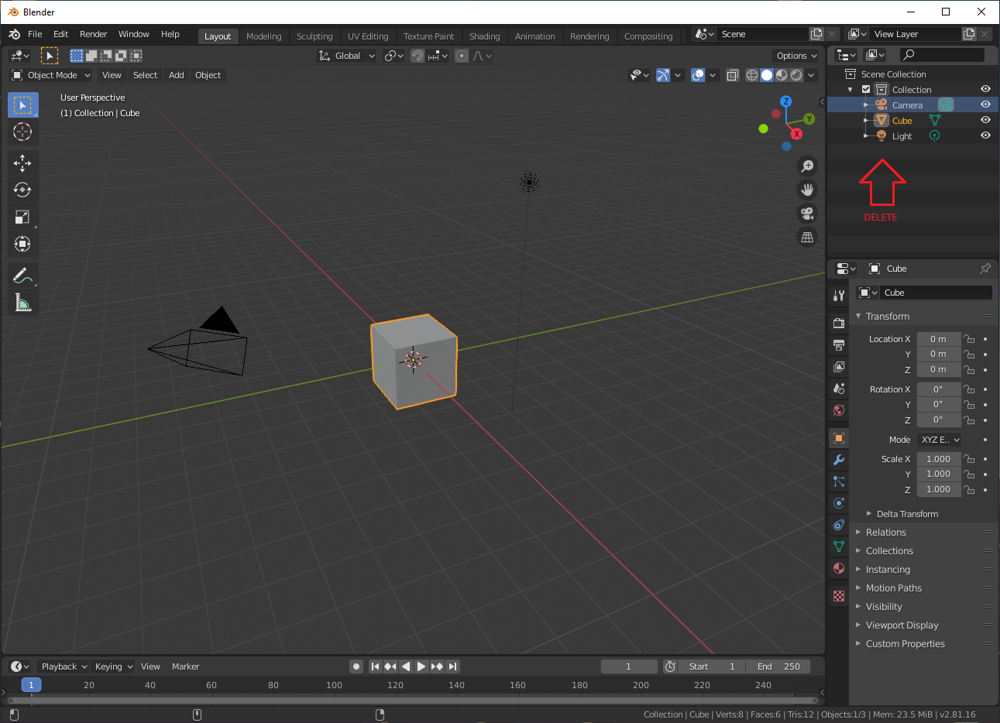
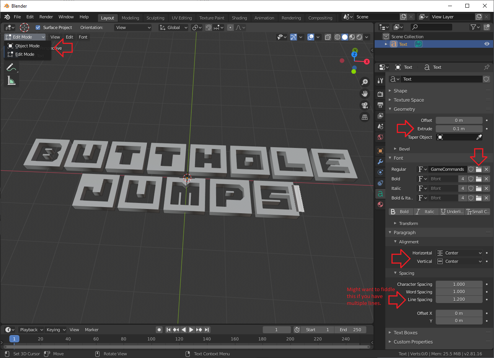
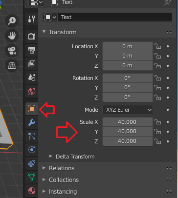
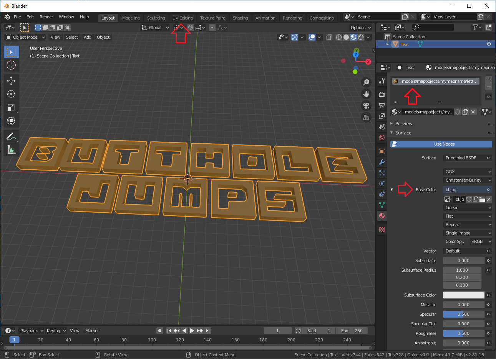
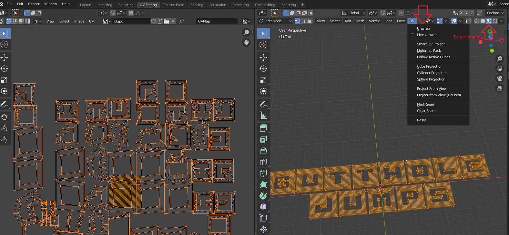
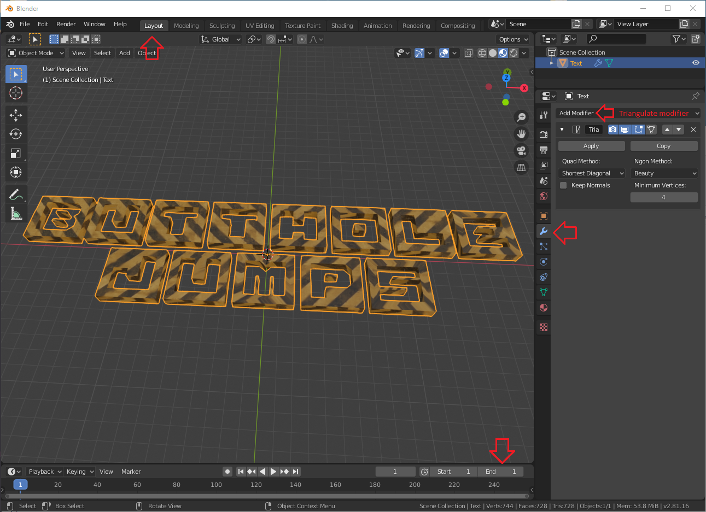
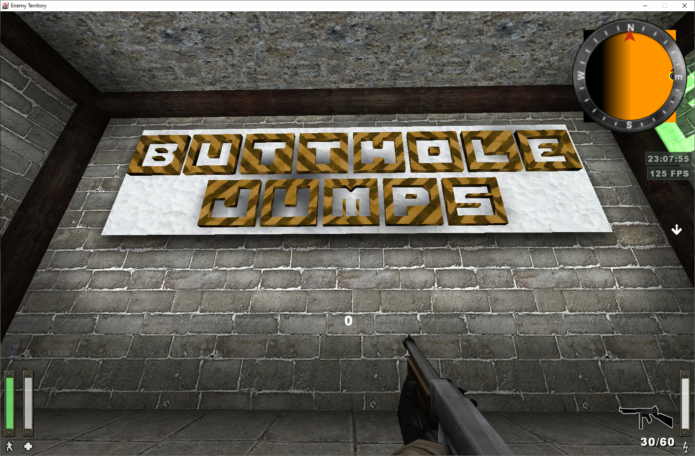
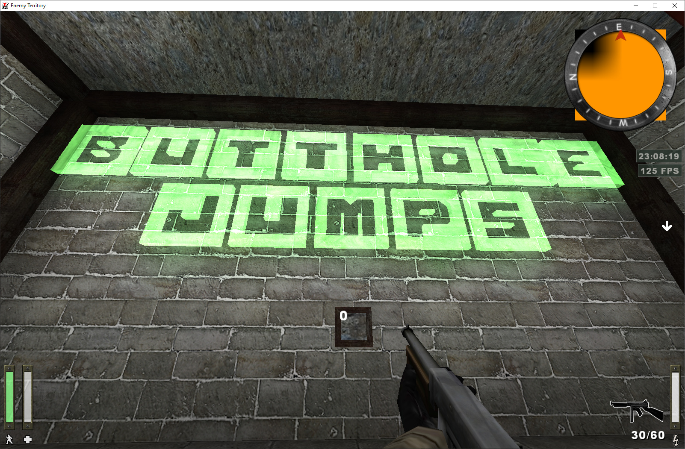

This tutorial will teach you how to make simple letters for your map in Blender and export them as MD3 models, along
with textures/shaders.

## Getting started

- Download and install [Blender](https://www.blender.org/download/).
- Open Blender, create a new General project.
- Before starting, install the [MD3 export plugin](/tutorials/sourcefiles/io_export_md3.zip).
  - Unzip the file to a location of your choice.
  - In Blender, go to `Edit` -> `Preferences` -> `Add-ons`
  - Select `Install...` at the top, browse to the extracted file and select `Install Add-on`
  - Click on the checkbox next to the plugin to enable it. The plugin should now be visible under `File` -> `Export` ->
    `MD3 (+shaders)`

## Creating the letters

- Delete everything in `Scene Collection` 

- Press `Add` button on top left or `Shift + A` and select `Text`
- Go to object data properties menu: green `a` symbol on right side menu.
  - Under `Paragraph` -> `Alignment`, set both `Horizontal` and `Vertical` alignment to `Center`.
  - Under `Font`, press the folder icon next to `Regular` text field and select your desired font.
  - Unless you want your text to be 2D (why?), go to `Geometry` and `Extrude` the text to your liking.
  - Hit `TAB` to edit your text.
  - Select `Object Mode` from the top left. 

- Right click on 3D window and select `Convert to Mesh`.
- Under `Object Properties`, `Scale` section, pump it up like 40x.
  

## Texturing

- Navigate to `Material Properties` menu, red ball thing on right side menu.
- Hit `New` and press the small circle next to `Base Color` and select `Image texture`. Click the folder icon and find
  your desired texture.
- Change the material name to match your texture / shader path. If using a shader, do not specify a file extension.
  

- Select `UV Editing` tab at the top.
  - On right side window press `A` to select everything, press the `UV` button at the top and select `Unwrap`
  - If you want to scale the texture, press `A` -> `X` -> `S` on the left side window and move your mouse to scale.
    

- Go back to the `Layout` tab at the top
  - Select `Modifier Properties` on the right, `Add Modifier` -> `Triangulate`
  - At the bottom of the 3D view, there are animation controls; set `End` to **1**
    

- Make sure your object is selected, and go to `File` -> `Export` -> `MD3 (+shaders)`

## Results

_Tutorial by {frontmatter.author}_
